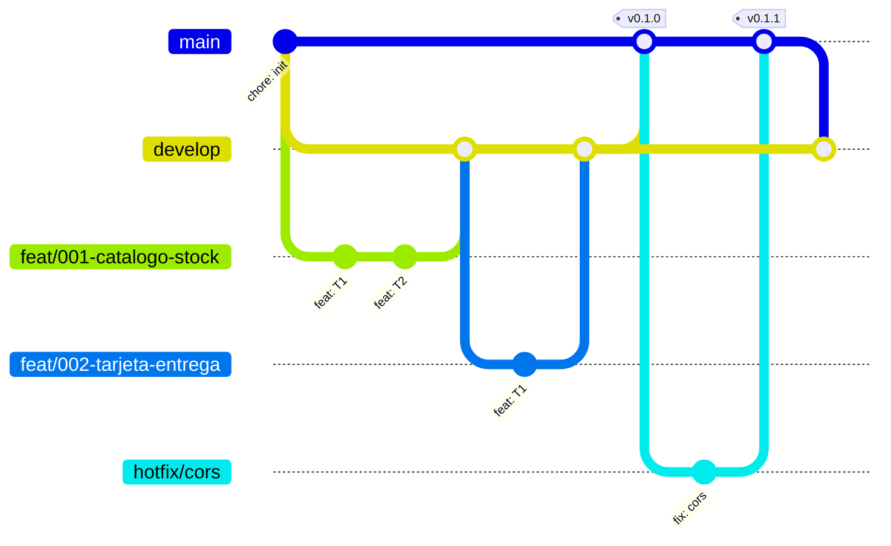

# AGENTS.md

Guía para cualquier agente de IA (Claude Code, Codex, Cursor, Copilot…) que trabaje en este repo.
Antes de escribir código, lee este archivo, `docs/contexto.md` y la spec en la que vas a trabajar.

## Producto

Checkout móvil de un producto pagado con tarjeta de crédito a través de una pasarela de pago (sandbox).
Flujo de 5 pantallas:

1. Producto (stock, descripción, precio)
2. Modal con tarjeta y datos de entrega
3. Resumen en backdrop: producto + tarifa base + envío
4. Resultado del pago
5. Vuelta al producto con el stock actualizado

Si el usuario recarga la página, la app recupera el paso en el que iba.

## Stack

| Capa | Tecnología |
|---|---|
| Frontend | React + Vite + TypeScript, Redux Toolkit (persistido), CSS con flexbox/grid, mobile-first (mín. iPhone SE 375×667) |
| Backend | NestJS + TypeScript, arquitectura hexagonal (puertos y adaptadores), Railway Oriented Programming |
| Base de datos | PostgreSQL + Prisma, con seed de productos (no hay endpoint para crear productos) |
| Tests | Jest, cobertura > 80 % en front y back |
| Docs API | Swagger (`@nestjs/swagger`) en `/docs` |
| Nube | AWS: front en S3 + CloudFront; back en Lambda (fuera de VPC) + API Gateway; BD en Neon (una sola branch para dev y prod, SSL). Plan B: back en Render |

## Reglas no negociables (constitución)

1. **Nada de lógica de negocio en los controladores.** Controlador → caso de uso → puertos. El dominio no importa NestJS ni Prisma.
2. **ROP:** los casos de uso devuelven `Result<T, DomainError>` y nunca lanzan excepciones por errores de negocio. El controlador traduce el `Result` a HTTP.
3. **Cobertura > 80 %** en cada paquete. Si baja, no se hace commit.
4. **Trazabilidad:** cada criterio de aceptación `AC-XXX-YY` tiene al menos un test con ese ID en su nombre.
5. **Datos sensibles:**
   - La tarjeta se tokeniza contra la pasarela. El número completo y el CVC nunca se guardan, nunca se loguean y nunca se persisten en localStorage.
   - Solo se guardan la marca y los últimos 4 dígitos.
6. **Secretos solo en variables de entorno** (`.env`, ignorado por git). Hay un `.env.example` sin valores reales.
7. **Nombre prohibido:** el nombre comercial de la pasarela no aparece en ningún archivo, commit, rama ni nombre del repo. Usa "payment gateway" o `gateway`.
8. **HTTP correcto:**
   - Códigos: 201 al crear, 400/422 si la validación falla, 404, 409 sin stock, 502 si la pasarela falla.
   - Los DTOs se validan con class-validator.
9. **Stock consistente:** el stock se descuenta en una transacción de BD solo cuando el pago queda APPROVED, nunca baja de 0, y hay idempotencia por referencia.
10. **Commits convencionales** (`feat:`, `fix:`, `test:`, `chore:`, `docs:`): una rama `feat/NNN-nombre` y un PR hacia `develop` por spec (ver *Git workflow*).

## Estructura

```
backend/src/
  domain/          entidades, value objects, errores, puertos (interfaces)
  application/     casos de uso (devuelven Result)
  infrastructure/  adaptadores: prisma/, gateway/, http/ (controladores, DTOs)
frontend/src/
  app/             store, hooks
  features/        product/, checkout/, payment/ (slice + componentes + tests)
  shared/          ui/, utils/ (validación Luhn, detección de marca)
specs/NNN-nombre/  spec.md · plan.md · tasks.md
scripts/           verify.sh · trace.ts
docs/              contexto.md · adr/
```

## Flujos de trabajo

El detalle de cada flujo está en su skill de proyecto (`.claude/skills/`):

- **`spec <nombre>`** → [`.claude/skills/spec/SKILL.md`](.claude/skills/spec/SKILL.md): spec.md con AC, plan.md y tasks.md, antes de escribir código.
- **`ship <NNN>`** → [`.claude/skills/ship/SKILL.md`](.claude/skills/ship/SKILL.md): rama `feat/NNN-nombre` desde `develop`, TDD con un commit por tarea y PR de vuelta a `develop`.
- **`verify`** → [`.claude/skills/verify/SKILL.md`](.claude/skills/verify/SKILL.md): ejecuta `scripts/verify.sh` y corrige hasta que pase.

## Git workflow

GitFlow ligero. **Nunca hagas `git push` sin que la persona lo pida.**

| Rama | Para qué | Sale de | Vuelve a |
|---|---|---|---|
| `main` | Solo releases: lo que está desplegado. Cada merge dispara el despliegue | — | — |
| `develop` | Integración (rama por defecto en GitHub) | `main` | `main` vía PR de release |
| `feat/NNN-nombre` | Una spec (flujo `ship`) | `develop` | `develop` vía PR |
| `hotfix/descripcion` | Arreglo urgente en producción | `main` | `main` **y** `develop` |

- Los PR se integran con **merge commit** (`gh pr merge --merge`), nunca `--squash`, para conservar el historial por tarea.
- **Release**: PR `develop → main`; tras el merge, tag anotado en `main` (`git tag -a v0.1.0 -m "…"`): `v0.1.0` = esqueleto desplegado, `v1.0.0` = entrega final.
- **Hotfix**: `git checkout -b hotfix/x main` → PR a `main` → tag de parche (`v1.0.1`) → PR (o merge) de `main` a `develop`.
- La CI (`.github/workflows/ci.yml`) corre en los PR y pushes hacia `develop` y `main`.



## Comandos

```bash
scripts/verify.sh                  # puerta de calidad completa (requiere FORBIDDEN_WORD exportada)
VERIFY_FAST=1 scripts/verify.sh    # lo que corre el pre-commit (sin builds ni npm audit)
npx tsx scripts/trace.ts           # matriz criterios → tests (todas las specs)
npx tsx scripts/trace.ts --spec 004
npx tsx scripts/trace.ts --shipped # solo specs con tasks.md completo (lo usa la CI)
cd backend && npm run test:cov
cd frontend && npm run test:cov
cd backend && npm run db:migrate && npm run db:seed
scripts/build-lambda.sh            # bundle de la Lambda en .build/ (poda peers y motores no usados)
scripts/deploy.sh                  # despliegue completo con CloudFormation (requiere aws configure y backend/.env.production)
```

## Lo que un agente NO debe hacer

- Hacer push sin que se lo pidan.
- Leer, imprimir o commitear `.env`.
- Debilitar tests o umbrales de cobertura para que algo pase.
- Agregar dependencias pesadas sin justificarlas en el PR.
