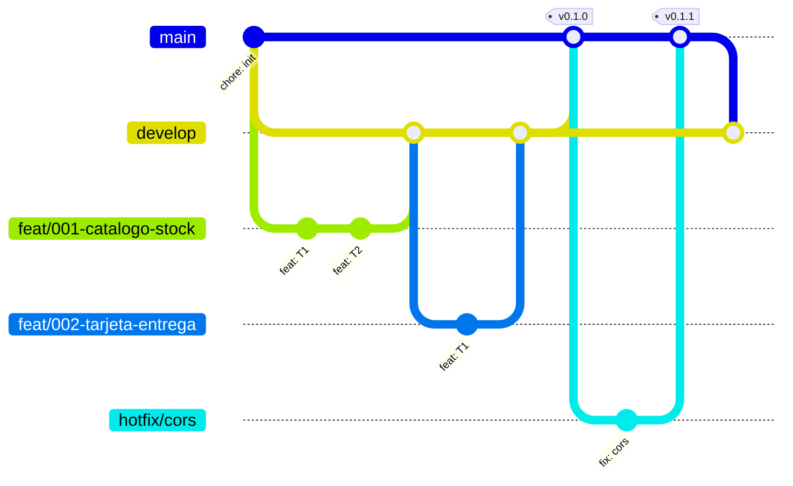

# Checkout challenge

Checkout móvil de un producto pagado con tarjeta de crédito a través de una pasarela de pago en modo **sandbox** (sin dinero real).

- **Frontend**: React + TypeScript (Vite), Redux Toolkit + redux-persist, mobile-first.
- **Backend**: NestJS + TypeScript, arquitectura hexagonal y Railway Oriented Programming, PostgreSQL (Neon) con Prisma.
- **Nube**: front en S3 + CloudFront; back en AWS Lambda + API Gateway.

> 🚧 README en construcción: arquitectura, modelo de datos, Swagger, cobertura, trazabilidad y URLs se completan en la entrega final.

## Estructura

```
backend/    API NestJS (domain / application / infrastructure)
frontend/   SPA React
specs/      Spec-Driven Development: spec.md · plan.md · tasks.md por funcionalidad
scripts/    verify.sh (puerta de calidad) · trace.ts (matriz AC → tests)
docs/       contexto y ADRs
```

## Desarrollo

```bash
npm install                      # raíz: husky + tsx
npm install --prefix backend
npm install --prefix frontend
cp backend/.env.example backend/.env      # completar valores
cp frontend/.env.example frontend/.env
export FORBIDDEN_WORD=...        # requerido por scripts/verify.sh
scripts/verify.sh
```

## Git workflow

GitFlow ligero.

| Rama | Para qué | Sale de | Vuelve a |
|---|---|---|---|
| `main` | Solo releases: lo que está desplegado. Cada merge dispara el despliegue | — | — |
| `develop` | Integración (rama por defecto en GitHub) | `main` | `main` vía PR de release |
| `feat/NNN-nombre` | Una spec (flujo `ship`) | `develop` | `develop` vía PR |
| `hotfix/descripcion` | Arreglo urgente en producción | `main` | `main` **y** `develop` |

- Los PR se integran con **merge commit** (`gh pr merge --merge`), nunca `--squash`, para conservar el historial por tarea.
- **Release**: PR `develop → main`; tras el merge, tag anotado en `main` (`git tag -a v0.1.0 -m "…"`): `v0.1.0` = esqueleto desplegado, `v1.0.0` = entrega final.
- **Hotfix**: `git checkout -b hotfix/x main` → PR a `main` → tag de parche (`v1.0.1`) → PR (o merge) de `main` a `develop`.
- La CI (`.github/workflows/ci.yml`) corre en los PR y pushes hacia `develop` y `main`.


