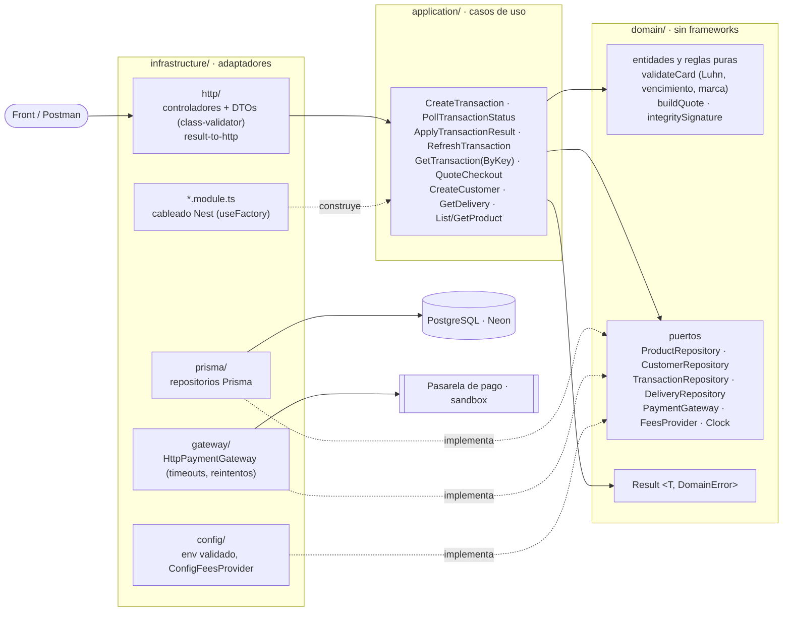
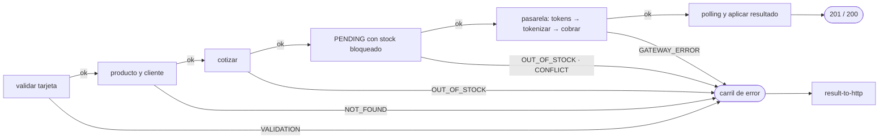
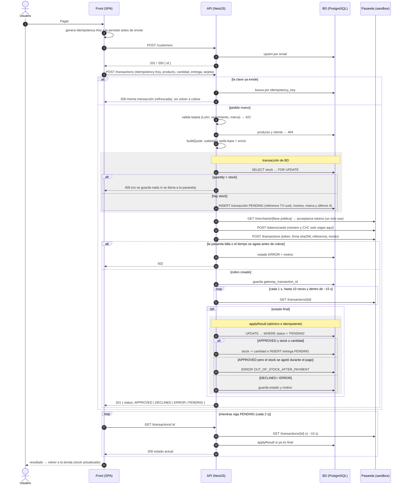
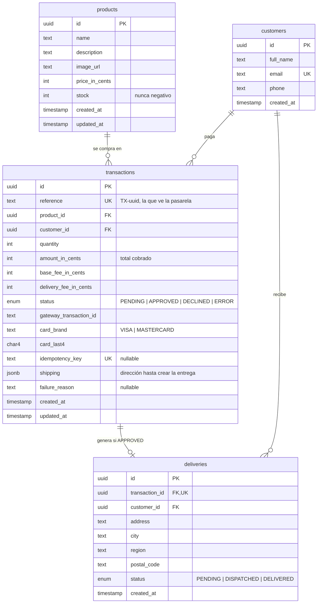
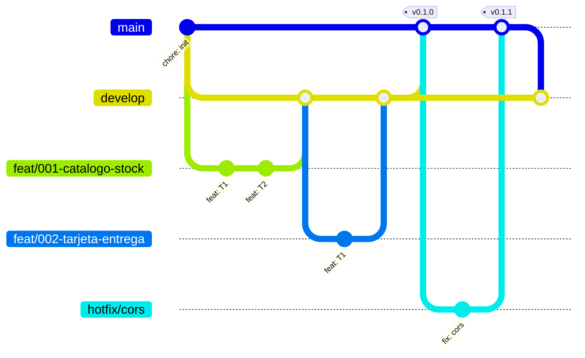

# Checkout challenge

Checkout móvil de un producto pagado con tarjeta de crédito a través de una pasarela de pago en modo **sandbox** (sin dinero real): producto → tarjeta y entrega → resumen → resultado → vuelta al producto con el stock actualizado. Si el usuario recarga, la app retoma el paso en el que iba.

| | URL |
|---|---|
| **App (front)** | <https://d3uvn5ovkcpvxw.cloudfront.net> |
| **API** | <https://nzeeql7sb7.execute-api.us-east-2.amazonaws.com> |
| **Swagger** | <https://nzeeql7sb7.execute-api.us-east-2.amazonaws.com/docs> |
| **Health** | <https://nzeeql7sb7.execute-api.us-east-2.amazonaws.com/health> |
| **Postman** | [`docs/postman.json`](docs/postman.json) |

- **Frontend**: React + TypeScript (Vite), Redux Toolkit + redux-persist, CSS mobile-first (desde iPhone SE 375×667).
- **Backend**: NestJS + TypeScript, arquitectura hexagonal (puertos y adaptadores) y Railway Oriented Programming.
- **Base de datos**: PostgreSQL serverless (Neon) con Prisma, conexión SSL.
- **Nube (AWS)**: front en S3 privado + CloudFront (OAC, HTTPS); back en Lambda (fuera de la VPC) + API Gateway HTTP API. Infraestructura en CloudFormation ([`infra/template.yaml`](infra/template.yaml)).
- **Seguridad**: HTTPS en ambos extremos; CloudFront agrega HSTS (`max-age=63072000; preload`), CSP `default-src 'self'`, `X-Frame-Options: DENY` y `nosniff`; la API usa `helmet`, CORS restringido al dominio del front y validación estricta de DTOs (`whitelist` + `forbidNonWhitelisted`). La tarjeta se tokeniza en la pasarela: el número y el CVC nunca se guardan, ni se loguean, ni llegan a `localStorage` (hay tests que lo prueban).

**Tarjetas del sandbox**: `4242 4242 4242 4242` → aprobada · `4111 1111 1111 1111` → rechazada (cualquier CVC de 3 dígitos y fecha futura).

## Contenido

- [Arquitectura](#arquitectura)
- [Flujo de pago](#flujo-de-pago)
- [Modelo de datos](#modelo-de-datos)
- [API](#api)
- [Calidad: cobertura y trazabilidad](#calidad-cobertura-y-trazabilidad)
- [Estructura](#estructura)
- [Desarrollo](#desarrollo)
- [Git workflow](#git-workflow)
- [Desarrollo asistido por IA](#desarrollo-asistido-por-ia)

## Arquitectura

### Backend: hexagonal (puertos y adaptadores)

Las dependencias apuntan hacia dentro: la infraestructura conoce a la aplicación y al dominio, nunca al revés. El **dominio no importa NestJS ni Prisma**, y los controladores no tienen lógica de negocio: validan el DTO, llaman a un caso de uso y traducen su `Result` a HTTP.



- Los casos de uso son clases TypeScript planas; los módulos de Nest los construyen con `useFactory` e inyectan los adaptadores por *token* (`PAYMENT_GATEWAY`, `TRANSACTION_REPOSITORY`…).
- En los tests se cambian los adaptadores por dobles en memoria (`backend/src/test/`): los casos de uso se prueban sin BD ni red, y los controladores con el stack HTTP real (pipes, filtros) sobre esos dobles.
- El tiempo es un puerto (`Clock`), así que el polling y los presupuestos de tiempo se prueban con tiempo virtual.

### Railway Oriented Programming

Cada caso de uso devuelve `Result<T, DomainError>` y **nunca lanza excepciones por errores de negocio**. Los pasos se encadenan con `andThen` / `andThenAsync`: el primer fallo desvía el resto del flujo al carril de error sin `try/catch`.

```ts
// domain/shared/result.ts
type Result<T, E> = { ok: true; value: T } | { ok: false; error: E };

// application/transactions/create-transaction.use-case.ts (simplificado)
return andThenAsync(timed((o) => gateway.getAcceptanceTokens(o)), (acceptance) =>
  andThenAsync(timed((o) => gateway.tokenizeCard(card, o)), (token) =>
    andThenAsync(timed((o) => gateway.createTransaction({ acceptance, cardToken: token.id, … }, o)),
      async (created) => {
        const marked = await transactions.markGatewayId(transaction.id, created.id);
        return andThenAsync(poll.execute(created, deadline), (latest) => apply.execute(marked, latest));
      })));
```



El controlador desenvuelve el `Result` con `unwrapOrThrow` (`infrastructure/http/result-to-http.ts`), el único sitio donde un error de dominio se convierte en código HTTP:

| `DomainError.code` | HTTP | Ejemplo |
|---|---|---|
| — (DTO inválido, antes del caso de uso) | 400 | `quantity: 0`, id que no es UUID, campo desconocido |
| `VALIDATION` | 422 | tarjeta que no pasa Luhn, vencida o de marca no soportada |
| `NOT_FOUND` | 404 | producto, cliente, transacción o entrega inexistente |
| `OUT_OF_STOCK` | 409 | cantidad mayor que el stock |
| `CONFLICT` | 409 | `Idempotency-Key` reutilizada con otro cuerpo |
| `GATEWAY_ERROR` | 502 | la pasarela falló, respondió algo inválido o se agotó el tiempo |

Las excepciones se reservan para lo que no es negocio (BD caída, invariantes rotas), y Nest las responde como 500.

### Frontend

- Features en `frontend/src/features/` (`product`, `checkout`, `payment`), cada una con su slice de Redux, componentes y tests; utilidades puras en `shared/utils` (Luhn, marca, máscaras, dinero).
- Slices: `products`, `checkout` (paso y datos de entrega), `cardSession` (tarjeta **solo en memoria**), `quote` y `payment`.
- redux-persist guarda **solo** `checkout` y `payment` (`whitelist`), con versión y migración: un estado viejo o corrupto vuelve a la pantalla de producto. Tras recargar, `resumeAfterReload` arregla el paso: si se recargó en pleno pago, busca la transacción por su `Idempotency-Key` persistida (`GET /transactions/by-key/:key`) y nunca paga dos veces; si estaba en el resumen sin tarjeta en memoria, vuelve al modal y la pide de nuevo. La pantalla de resultado retoma sola la consulta de una transacción PENDING.

## Flujo de pago



## Modelo de datos

PostgreSQL (Neon) con Prisma; migraciones en `backend/prisma/migrations`. Los productos llegan por seed (no hay endpoint para crearlos). Montos en **centavos de COP** (`Int`).



- De la tarjeta solo se guardan `card_brand` y `card_last4`. El número y el CVC solo viajan a la pasarela para tokenizarse.
- `subtotal = amount_in_cents − base_fee_in_cents − delivery_fee_in_cents`; los tres montos se calculan en el backend y quedan congelados en la transacción.
- `deliveries.transaction_id` es único: como mucho una entrega por pago, aunque el resultado se aplique dos veces.

## API

- **Swagger**: `/docs` (local: <http://localhost:3000/docs>; desplegada: <https://nzeeql7sb7.execute-api.us-east-2.amazonaws.com/docs>).
- **Postman**: colección en [`docs/postman.json`](docs/postman.json) (importar en Postman; variable `baseUrl`, por defecto `http://localhost:3000`, o `https://nzeeql7sb7.execute-api.us-east-2.amazonaws.com` para la API desplegada). Las carpetas se ejecutan en orden y se pasan solas `customerId`, `transactionId`, `idempotencyKey` y `deliveryId`; cubre los caminos felices y los códigos 400, 404, 409, 422 y la repetición idempotente.
- Errores con forma única: `{ "statusCode": 409, "error": "Conflict", "message": "Only 5 unit(s) of product … left" }`.
- Montos en centavos de COP. Ejemplos con las tarifas por defecto (`BASE_FEE_IN_CENTS=300000`, `DELIVERY_FEE_IN_CENTS=800000`).

| Método | Ruta | Códigos | Ejemplo |
|---|---|---|---|
| GET | `/products` | 200 | → `[{ "id": "6f1d…0001", "name": "Audífonos inalámbricos", "priceInCents": 24990000, "stock": 10, … }]` |
| GET | `/products/:id` | 200, 400 (id no UUID), 404 | `/products/6f1d2c3a-0000-4000-8000-000000000001` → el producto con su stock |
| GET | `/products/:id/quote?quantity=n` | 200, 400 (n ∉ 1..10 o id no UUID), 404, 409 (sin stock) | `?quantity=2` → `{ "subtotalInCents": 49980000, "baseFeeInCents": 300000, "deliveryFeeInCents": 800000, "totalInCents": 51080000, "currency": "COP", … }` |
| POST | `/customers` | 201 (nuevo), 200 (email ya existía: mismo id, datos actualizados), 400 | `{ "fullName": "Ana Pérez", "email": "ana@example.com", "phone": "+573001234567" }` → `{ "id": "…", … }` |
| POST | `/transactions` | 201, 200 (misma `Idempotency-Key`), 400, 404, 409 (sin stock o clave reutilizada con otro cuerpo), 422 (tarjeta: Luhn, vencida o marca), 502 (pasarela) | Header `Idempotency-Key: <uuid>`; cuerpo `{ "productId", "customerId", "quantity": 1, "shipping": { "address", "city", "region", "postalCode" }, "card": { "number": "4242424242424242", "cvc": "123", "expMonth": "12", "expYear": "29", "holderName": "Ana Perez" } }` → `{ "id", "reference": "TX-…", "status": "APPROVED", "totalInCents": 26090000, "cardBrand": "VISA", "cardLast4": "4242", "delivery": { "status": "PENDING", … } }` |
| GET | `/transactions/:id` | 200, 400, 404, 502 | Si sigue PENDING consulta la pasarela y aplica el resultado → `{ "status": "DECLINED", "failureReason": "La transacción fue rechazada (Sandbox)", "delivery": null, … }` |
| GET | `/transactions/by-key/:idempotencyKey` | 200, 400, 404, 502 | Recupera un pago cuya respuesta se perdió (recarga en pleno pago) → misma forma que `GET /transactions/:id` |
| GET | `/deliveries/:id` | 200, 400, 404 | → `{ "id", "transactionId", "customerId", "address": "Calle 1 # 2-3", "city": "Bogotá", "region": "Cundinamarca", "postalCode": "110111", "status": "PENDING" }` |
| GET | `/health` | 200 | → `{ "status": "ok" }` |

### Límites de tiempo

API Gateway corta a los ~30 s, así que la API se acota mucho antes:

| Dónde | Límite | Si se agota | AC |
|---|---|---|---|
| Cada llamada a la pasarela | 8 s (o lo que quede del presupuesto, si es menos) | `GATEWAY_ERROR` | AC-005-11 |
| `POST /transactions` completo | ~15 s desde que llega la petición | cobro ya creado → `201` con `status: "PENDING"` y el front sigue con `GET /transactions/:id`; antes de cobrar → `502`, la transacción queda en ERROR y no se cobra nada | AC-005-14 |
| Polling del estado dentro del `POST` | cada 1 s, hasta 10 veces, sin pasar del presupuesto | responde PENDING | AC-004-08 |
| Consulta de estado en `GET /transactions/:id` y `by-key` | ~10 s en total con reintentos | `502` y la transacción sigue PENDING para la siguiente consulta | AC-005-15 |
| Reintentos | solo las lecturas de estado (GET), hasta 2, y solo si queda tiempo útil; tokenizar y cobrar **nunca** se reintentan | — | AC-005-12 |

El front consulta cada 2 s hasta un estado final, como mucho 2 min (AC-004-18).

## Calidad: cobertura y trazabilidad

### Cobertura

Jest en los dos paquetes, con umbral **≥ 80 %** en sentencias, ramas, funciones y líneas (lo aplica la config de Jest de cada paquete; si baja, `verify.sh` falla y no hay commit).

| Paquete | Tests | Sentencias | Ramas | Funciones | Líneas |
|---|---|---|---|---|---|
| Backend (`backend/`) | 189 tests · 36 suites | **100 %** (677/677) | **91.54 %** (303/331) | **100 %** (133/133) | **100 %** (593/593) |
| Frontend (`frontend/`) | 183 tests · 31 suites | **99.5 %** (609/612) | **93.68 %** (267/285) | **99.34 %** (152/153) | **100 %** (517/517) |

```bash
cd backend && npm run test:cov
cd frontend && npm run test:cov
```

La CI publica en el *job summary* de cada PR el resumen de cobertura de los dos paquetes y la matriz de trazabilidad.

### Trazabilidad: 67/67 criterios con test

Cada criterio de aceptación `AC-NNN-YY` de `specs/*/spec.md` tiene al menos un test con ese ID en el nombre (`it('AC-004-12 …')`). [`scripts/trace.ts`](scripts/trace.ts) arma la matriz y falla si falta alguno; la CI la corre con `--shipped`.

| Spec | Qué cubre | AC | Con test |
|---|---|---|---|
| [001 · catálogo y stock](specs/001-catalogo-stock/spec.md) | productos, stock, pantalla de producto | 10 | ✅ 10 |
| [002 · tarjeta y entrega](specs/002-tarjeta-entrega/spec.md) | modal, Luhn, vencimiento, CVC, marca, datos de entrega | 11 | ✅ 11 |
| [003 · resumen de pago](specs/003-resumen-pago/spec.md) | cotización en el backend, backdrop de resumen | 10 | ✅ 10 |
| [004 · transacción con la pasarela](specs/004-transaccion-pasarela/spec.md) | clientes, transacción, pasarela, entrega, stock, resultado | 21 | ✅ 21 |
| [005 · resiliencia](specs/005-resiliencia/spec.md) | recuperar el paso tras recargar, idempotencia, timeouts | 15 | ✅ 15 |
| **Total** | | **67** | **✅ 67/67** |

```bash
npx tsx scripts/trace.ts             # matriz completa (todas las specs)
npx tsx scripts/trace.ts --spec 004  # una spec
```

<details>
<summary>Matriz completa AC → tests (salida de <code>scripts/trace.ts</code>)</summary>

| AC | Archivo | Estado |
|---|---|---|
| AC-001-01 | backend/src/application/products/list-products.use-case.spec.ts<br>backend/src/infrastructure/http/products.controller.spec.ts<br>backend/src/infrastructure/prisma/prisma-product.repository.spec.ts | ✅ |
| AC-001-02 | backend/src/application/products/get-product.use-case.spec.ts<br>backend/src/infrastructure/http/products.controller.spec.ts<br>backend/src/infrastructure/prisma/prisma-product.repository.spec.ts | ✅ |
| AC-001-03 | backend/src/application/products/get-product.use-case.spec.ts<br>backend/src/infrastructure/http/products.controller.spec.ts<br>backend/src/infrastructure/prisma/prisma-product.repository.spec.ts | ✅ |
| AC-001-04 | backend/src/infrastructure/http/products.controller.spec.ts | ✅ |
| AC-001-05 | backend/src/infrastructure/prisma/seed-products.spec.ts | ✅ |
| AC-001-06 | frontend/src/features/product/ProductList.test.tsx<br>frontend/src/shared/api/http.test.ts<br>frontend/src/shared/config.test.ts<br>frontend/src/shared/utils/money.test.ts | ✅ |
| AC-001-07 | frontend/src/app/store.test.ts<br>frontend/src/features/product/ProductList.test.tsx<br>frontend/src/features/product/productsSlice.test.ts | ✅ |
| AC-001-08 | frontend/src/features/product/ProductList.test.tsx | ✅ |
| AC-001-09 | frontend/src/features/checkout/startCheckout.test.tsx | ✅ |
| AC-001-10 | frontend/src/features/product/ProductImage.test.tsx | ✅ |
| AC-002-01 | frontend/src/features/checkout/CheckoutDetails.fields.test.tsx<br>frontend/src/shared/utils/card.test.ts | ✅ |
| AC-002-02 | frontend/src/features/checkout/CheckoutDetails.fields.test.tsx<br>frontend/src/shared/ui/BrandLogo.test.tsx<br>frontend/src/shared/utils/brand.test.ts | ✅ |
| AC-002-03 | frontend/src/features/checkout/CheckoutDetails.fields.test.tsx<br>frontend/src/shared/utils/card.test.ts | ✅ |
| AC-002-04 | frontend/src/features/checkout/CheckoutDetails.fields.test.tsx<br>frontend/src/shared/utils/cardFields.test.ts | ✅ |
| AC-002-05 | frontend/src/features/checkout/CheckoutDetails.fields.test.tsx<br>frontend/src/shared/utils/cardFields.test.ts | ✅ |
| AC-002-06 | frontend/src/features/checkout/CheckoutDetails.fields.test.tsx<br>frontend/src/shared/utils/cardFields.test.ts | ✅ |
| AC-002-07 | frontend/src/features/checkout/CheckoutDetails.fields.test.tsx<br>frontend/src/shared/utils/delivery.test.ts | ✅ |
| AC-002-08 | frontend/src/features/checkout/CheckoutDetails.flow.test.tsx | ✅ |
| AC-002-09 | frontend/src/features/checkout/CheckoutDetails.flow.test.tsx<br>frontend/src/features/checkout/cardSession.test.ts | ✅ |
| AC-002-10 | frontend/src/features/checkout/CheckoutDetails.flow.test.tsx<br>frontend/src/shared/ui/Modal.test.tsx | ✅ |
| AC-002-11 | frontend/src/features/checkout/CheckoutDetails.fields.test.tsx<br>frontend/src/shared/ui/Modal.test.tsx | ✅ |
| AC-003-01 | backend/src/application/quote/quote-checkout.use-case.spec.ts<br>backend/src/domain/quote/quote.spec.ts<br>backend/src/infrastructure/config/config-fees.provider.spec.ts<br>backend/src/infrastructure/http/products.controller.spec.ts | ✅ |
| AC-003-02 | backend/src/application/quote/quote-checkout.use-case.spec.ts<br>backend/src/domain/quote/quote.spec.ts<br>backend/src/infrastructure/http/products.controller.spec.ts | ✅ |
| AC-003-03 | backend/src/application/quote/quote-checkout.use-case.spec.ts<br>backend/src/domain/quote/quote.spec.ts<br>backend/src/infrastructure/http/products.controller.spec.ts | ✅ |
| AC-003-04 | frontend/src/features/payment/SummarySheet.test.tsx<br>frontend/src/features/payment/quoteSlice.test.ts | ✅ |
| AC-003-05 | frontend/src/features/payment/SummarySheet.test.tsx | ✅ |
| AC-003-06 | frontend/src/features/payment/QuantityStepper.test.tsx | ✅ |
| AC-003-07 | frontend/src/features/payment/PayButton.test.tsx | ✅ |
| AC-003-08 | frontend/src/features/payment/PayButton.test.tsx | ✅ |
| AC-003-09 | frontend/src/features/payment/SummarySheet.test.tsx<br>frontend/src/features/payment/quoteSlice.test.ts | ✅ |
| AC-003-10 | frontend/src/features/payment/SummarySheet.test.tsx | ✅ |
| AC-004-01 | backend/src/application/customers/create-customer.use-case.spec.ts<br>backend/src/infrastructure/http/customers.controller.spec.ts<br>backend/src/infrastructure/prisma/prisma-customer.repository.spec.ts | ✅ |
| AC-004-02 | backend/src/application/transactions/create-transaction.use-case.spec.ts<br>backend/src/infrastructure/http/transactions.controller.spec.ts | ✅ |
| AC-004-03 | backend/src/application/transactions/create-transaction.use-case.spec.ts<br>backend/src/infrastructure/http/transactions.controller.spec.ts<br>backend/src/infrastructure/prisma/prisma-transaction.repository.spec.ts | ✅ |
| AC-004-04 | backend/src/application/transactions/create-transaction.use-case.spec.ts<br>backend/src/infrastructure/http/transactions.controller.spec.ts<br>backend/src/infrastructure/prisma/prisma-transaction.repository.spec.ts | ✅ |
| AC-004-05 | backend/src/application/transactions/create-transaction.use-case.spec.ts<br>backend/src/domain/payment/card.spec.ts<br>backend/src/infrastructure/gateway/http-payment-gateway.spec.ts<br>backend/src/infrastructure/http/transactions.controller.spec.ts | ✅ |
| AC-004-06 | backend/src/domain/payment/signature.spec.ts | ✅ |
| AC-004-07 | backend/src/application/transactions/create-transaction.use-case.spec.ts<br>backend/src/infrastructure/gateway/http-payment-gateway.spec.ts<br>backend/src/infrastructure/prisma/prisma-transaction.repository.spec.ts | ✅ |
| AC-004-08 | backend/src/application/transactions/create-transaction.use-case.spec.ts<br>backend/src/application/transactions/poll-transaction-status.use-case.spec.ts<br>backend/src/domain/shared/clock.spec.ts<br>backend/src/infrastructure/gateway/http-payment-gateway.spec.ts<br>backend/src/infrastructure/http/transactions.controller.spec.ts | ✅ |
| AC-004-09 | backend/src/application/transactions/create-transaction.use-case.spec.ts<br>backend/src/infrastructure/prisma/prisma-transaction.repository.spec.ts | ✅ |
| AC-004-10 | backend/src/application/transactions/apply-transaction-result.use-case.spec.ts<br>backend/src/application/transactions/create-transaction.use-case.spec.ts<br>backend/src/infrastructure/prisma/prisma-transaction.repository.spec.ts | ✅ |
| AC-004-11 | backend/src/application/transactions/apply-transaction-result.use-case.spec.ts<br>backend/src/infrastructure/prisma/prisma-transaction.repository.spec.ts | ✅ |
| AC-004-12 | backend/src/application/transactions/apply-transaction-result.use-case.spec.ts<br>backend/src/infrastructure/prisma/prisma-transaction.repository.spec.ts | ✅ |
| AC-004-13 | backend/src/application/transactions/create-transaction.use-case.spec.ts<br>backend/src/infrastructure/gateway/http-payment-gateway.spec.ts<br>backend/src/infrastructure/http/transactions.controller.spec.ts | ✅ |
| AC-004-14 | backend/src/application/transactions/get-transaction.use-case.spec.ts<br>backend/src/infrastructure/gateway/http-payment-gateway.spec.ts<br>backend/src/infrastructure/http/transactions.controller.spec.ts<br>backend/src/infrastructure/prisma/prisma-transaction.repository.spec.ts | ✅ |
| AC-004-15 | backend/src/application/deliveries/get-delivery.use-case.spec.ts<br>backend/src/infrastructure/http/deliveries.controller.spec.ts<br>backend/src/infrastructure/prisma/prisma-delivery.repository.spec.ts | ✅ |
| AC-004-16 | backend/src/test/card-leak.spec.ts | ✅ |
| AC-004-17 | frontend/src/features/payment/ResultScreen.test.tsx | ✅ |
| AC-004-18 | frontend/src/features/payment/ResultScreen.test.tsx<br>frontend/src/features/payment/paymentSlice.test.ts | ✅ |
| AC-004-19 | frontend/src/features/payment/ResultScreen.test.tsx | ✅ |
| AC-004-20 | frontend/src/features/payment/paymentSlice.test.ts | ✅ |
| AC-004-21 | backend/src/application/transactions/create-transaction.use-case.spec.ts<br>backend/src/infrastructure/prisma/prisma-transaction.repository.spec.ts | ✅ |
| AC-005-01 | frontend/src/app/resumeAfterReload.test.tsx | ✅ |
| AC-005-02 | frontend/src/app/resumeAfterReload.test.tsx | ✅ |
| AC-005-03 | frontend/src/app/resumeAfterReload.test.tsx | ✅ |
| AC-005-04 | frontend/src/app/resumeAfterReload.test.tsx | ✅ |
| AC-005-05 | frontend/src/app/recoverPayment.test.tsx | ✅ |
| AC-005-06 | frontend/src/app/noCardLeak.test.tsx | ✅ |
| AC-005-07 | frontend/src/app/persistence.test.ts | ✅ |
| AC-005-08 | frontend/src/app/persistence.test.ts<br>frontend/src/app/resumeAfterReload.test.tsx | ✅ |
| AC-005-09 | backend/src/application/transactions/create-transaction.idempotency.spec.ts<br>backend/src/infrastructure/http/transactions.controller.spec.ts | ✅ |
| AC-005-10 | backend/src/application/transactions/create-transaction.idempotency.spec.ts<br>backend/src/infrastructure/http/transactions.controller.spec.ts<br>backend/src/infrastructure/prisma/prisma-transaction.repository.spec.ts | ✅ |
| AC-005-11 | backend/src/infrastructure/gateway/gateway-config.spec.ts<br>backend/src/infrastructure/gateway/http-payment-gateway.spec.ts | ✅ |
| AC-005-12 | backend/src/infrastructure/gateway/http-payment-gateway.spec.ts<br>backend/src/infrastructure/gateway/retry.spec.ts | ✅ |
| AC-005-13 | backend/src/application/transactions/get-transaction-by-key.use-case.spec.ts<br>backend/src/infrastructure/http/transactions.controller.spec.ts<br>backend/src/infrastructure/prisma/prisma-transaction.repository.spec.ts | ✅ |
| AC-005-14 | backend/src/application/transactions/create-transaction.time-budget.spec.ts<br>backend/src/infrastructure/gateway/http-payment-gateway.spec.ts<br>backend/src/infrastructure/http/transactions.controller.spec.ts | ✅ |
| AC-005-15 | backend/src/application/transactions/get-transaction.use-case.spec.ts<br>backend/src/infrastructure/gateway/http-payment-gateway.spec.ts<br>backend/src/infrastructure/http/transactions.controller.spec.ts | ✅ |

</details>

## Estructura

```
backend/
  src/domain/          entidades, reglas puras, puertos (interfaces), Result y DomainError
  src/application/     casos de uso (devuelven Result)
  src/infrastructure/  adaptadores: http/ (controladores, DTOs), prisma/, gateway/, config/, módulos Nest
  src/test/            dobles en memoria de los puertos y helpers de tests
  prisma/              schema, migraciones, seed, reset-demo
frontend/src/
  app/                 store, persistencia, rehidratación por paso
  features/            product/, checkout/, payment/ (slice + componentes + tests)
  shared/              ui/, utils/ (Luhn, marca, dinero), api/
specs/NNN-nombre/      spec.md · plan.md · tasks.md por funcionalidad
docs/                  contexto.md · adr/ · postman.json
infra/                 template.yaml (CloudFormation)
scripts/               verify.sh · trace.ts · build-lambda.sh · deploy.sh
.claude/skills/        skills de proyecto: spec · ship · verify
AGENTS.md              constitución para agentes de IA (CLAUDE.md la importa)
```

## Desarrollo

Requisitos: Node 24 (la versión de la CI) y npm; una base PostgreSQL (Neon) y las llaves de prueba del sandbox de la pasarela. `gitleaks` es opcional en local (la CI lo corre siempre).

```bash
npm install                      # raíz: husky (pre-commit) + tsx
npm install --prefix backend     # genera el cliente de Prisma
npm install --prefix frontend
cp backend/.env.example backend/.env      # completar valores (nunca se commitea)
cp frontend/.env.example frontend/.env    # VITE_API_URL
```

Variables del backend (`backend/.env.example`): `DATABASE_URL` (pooled), `DIRECT_DATABASE_URL` (sin pooler, solo migraciones), `GATEWAY_BASE_URL`, `GATEWAY_PUBLIC_KEY`, `GATEWAY_PRIVATE_KEY`, `GATEWAY_INTEGRITY_SECRET`, `GATEWAY_EVENTS_SECRET` (preparada, sin uso), `BASE_FEE_IN_CENTS`, `DELIVERY_FEE_IN_CENTS` y `CORS_ORIGINS`. Se validan al arrancar, y si falta alguna la API no levanta (el error dice qué nombres faltan, nunca los valores).

```bash
cd backend && npm run start:dev     # API en http://localhost:3000 (Swagger en /docs)
cd frontend && npm run dev          # SPA en http://localhost:5173
```

### Base de datos y datos de demo (`db:reset-demo`)

```bash
cd backend
npm run db:deploy        # aplica las migraciones pendientes (usa DIRECT_DATABASE_URL)
npm run db:seed          # crea los productos de ejemplo que falten; no toca el stock existente
npm run db:reset-demo    # deja la demo como recién sembrada (ver abajo)
```

`db:reset-demo` sirve para limpiar después de probar pagos en el sandbox. En **una sola transacción de BD**:

1. Borra **todas** las entregas, transacciones y clientes (en ese orden, por las claves foráneas).
2. Repone el stock de los productos del seed a sus valores iniciales.
3. No borra productos.

> ⚠️ Es destructivo y actúa sobre la base de `DATABASE_URL`. La demo usa una sola base de Neon para dev y prod, así que también vacía los pagos hechos desde la app desplegada. Solo hay datos de sandbox, pero úsalo a conciencia.

El seed **no** repone stock a propósito (`upsert` con `update: {}`), para no deshacer ventas al redesplegar; por eso existe `db:reset-demo`.

### Puerta de calidad

```bash
export FORBIDDEN_WORD=...          # palabra que no puede aparecer en el repo; nunca se escribe en un archivo
scripts/verify.sh                  # lint, typecheck, tests + cobertura, build, npm audit (back y front), gitleaks y nombre prohibido
VERIFY_FAST=1 scripts/verify.sh    # variante del pre-commit (sin build ni audit)
npx tsx scripts/trace.ts           # matriz AC → tests
```

### Despliegue

```bash
aws configure                      # credenciales de la cuenta (región us-east-2)
scripts/build-lambda.sh            # bundle de la Lambda en .build/ (poda dependencias no usadas)
scripts/deploy.sh                  # CloudFormation (infra/template.yaml): Lambda + API Gateway + S3 + CloudFront, migraciones, seed, subida de la SPA y smoke test
```

`deploy.sh` lee `backend/.env.production`, que no se commitea. Las decisiones de infraestructura están en [`docs/adr/0001-neon-y-lambda.md`](docs/adr/0001-neon-y-lambda.md).

## Git workflow

GitFlow ligero.

| Rama | Para qué | Sale de | Vuelve a |
|---|---|---|---|
| `main` | Solo releases: lo que está desplegado. Cada merge dispara el despliegue | — | — |
| `develop` | Integración (rama por defecto en GitHub) | `main` | `main` vía PR de release |
| `feat/NNN-nombre` | Una spec (flujo `ship`) | `develop` | `develop` vía PR |
| `hotfix/descripcion` | Arreglo urgente en producción | `main` | `main` **y** `develop` |

- Los PR se integran con **merge commit** (`gh pr merge --merge`), nunca `--squash`, para conservar el historial por tarea.
- **Release**: PR `develop → main`; tras el merge, tag anotado en `main` (`git tag -a v0.1.0 -m "…"`): `v0.1.0` = esqueleto desplegado, `v1.0.0` = entrega final.
- **Hotfix**: `git checkout -b hotfix/x main` → PR a `main` → tag de parche (`v1.0.1`) → PR (o merge) de `main` a `develop`.
- La CI (`.github/workflows/ci.yml`) corre en los PR y pushes hacia `develop` y `main`.



## Desarrollo asistido por IA

El proyecto se hizo con agentes de IA (Claude Code) bajo **Spec-Driven Development**: primero la spec y sus criterios, luego el código, y una puerta de calidad automática que el agente no puede saltarse. La persona decide qué se construye, aprueba las specs, revisa los PR y autoriza cada push.

```mermaid
flowchart LR
  P["prompt de la prueba<br/>docs/contexto.md"] --> SPEC["skill spec<br/>spec.md (AC Dado/Cuando/Entonces)<br/>plan.md · tasks.md"]
  SPEC -->|"aprobada por la persona"| SHIP["skill ship<br/>rama feat/NNN · TDD por tarea"]
  SHIP --> T["test con el ID del AC"] --> C["código mínimo"] --> V{"verify.sh"}
  V -->|"falla"| C
  V -->|"pasa"| CM["commit por tarea<br/>casilla marcada en tasks.md"]
  CM -->|"siguiente tarea"| T
  CM --> TR{"trace.ts"}
  TR -->|"todos los AC con test"| PR["PR a develop<br/>(push solo con OK)"]
  PR --> CI["CI: verify + trace --shipped"] --> M["merge commit"]
```



### Piezas

- **[`AGENTS.md`](AGENTS.md)**: la "constitución" que cualquier agente lee antes de escribir código (Claude Code la carga desde `CLAUDE.md`; sirve también para Codex, Cursor o Copilot). Fija el stack, la estructura y reglas no negociables: nada de lógica en controladores, ROP, cobertura > 80 %, un test por AC, datos de tarjeta nunca guardados, secretos solo en `.env`, nombre comercial de la pasarela prohibido, códigos HTTP correctos, stock consistente, commits convencionales y **nunca hacer push sin permiso**.
- **SDD en [`specs/`](specs/)**: cada funcionalidad tiene `spec.md` (objetivo, alcance, criterios `AC-NNN-YY` en Dado/Cuando/Entonces, casos borde), `plan.md` (diseño por capas) y `tasks.md` (tareas de ≤ 1 h, cada una con sus AC). Cuando algo cambió durante el desarrollo (por ejemplo, los límites de tiempo AC-005-14 y AC-005-15) se agregó primero el AC a la spec y después el código.
- **Skills de proyecto** ([`.claude/skills/`](.claude/skills/)):
  - [`spec`](.claude/skills/spec/SKILL.md): crea `specs/NNN-nombre/` con spec, plan y tareas antes de escribir código.
  - [`ship`](.claude/skills/ship/SKILL.md): implementa una spec aprobada. Crea la rama `feat/NNN-nombre` desde `develop` y, tarea por tarea, escribe el test que falla, el código mínimo, pasa `verify` y hace un commit pequeño con la casilla marcada. Al final corre `trace` y abre el PR a `develop` (pidiendo permiso antes del push).
  - [`verify`](.claude/skills/verify/SKILL.md): corre `scripts/verify.sh` y corrige hasta que pase, sin bajar umbrales, saltar pasos ni usar `--no-verify`.
- **[`scripts/verify.sh`](scripts/verify.sh)**: una sola puerta de calidad para la persona, el agente, el pre-commit (Husky, variante rápida) y la CI. Corre lint, typecheck, tests con cobertura, build y `npm audit` en los dos paquetes, `gitleaks` y la búsqueda del nombre prohibido en archivos, nombres de archivo, ramas, commits y remotos.
- **[`scripts/trace.ts`](scripts/trace.ts)**: matriz criterios → tests. Falla si un AC no tiene test; la CI la corre solo sobre las specs con `tasks.md` completo (`--shipped`).
- **ADRs** ([`docs/adr/`](docs/adr/)): las decisiones (Neon + Lambda, versiones de herramientas, contrato del sandbox de la pasarela, probado con `curl` antes de escribir el adaptador) quedan escritas para que la siguiente sesión del agente no las vuelva a discutir.

### Agentes en paralelo con `git worktree`

El segundo día trabajaron dos agentes a la vez sobre el mismo repo, cada uno en su propio directorio y su propia rama:

```bash
git worktree add ../pt-backend feat/004-transaccion-pasarela   # agente de backend
# el checkout principal queda para el agente de frontend (feat/00N-…-front)
git worktree list
```

- Cada worktree tiene sus `node_modules`, su `.env` y su rama, así que los dos agentes pueden correr `verify.sh` y commitear sin pisarse. Comparten el historial: lo que uno integra en `develop` el otro lo trae con un merge.
- Para que no haya conflictos se reparte el terreno por carpeta: el agente de backend no toca `frontend/` y viceversa. Los archivos compartidos (README, specs) tienen un solo dueño a la vez.
- El contrato entre los dos es la API documentada en las specs y en Swagger. El agente de backend publica los endpoints con tests HTTP, y el de frontend los consume con dobles en sus tests.
- Cuidado: el `git stash` es común a todos los worktrees, así que para dejar trabajo a un lado se usa un commit WIP o una rama local.
